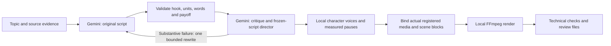

# Reusable editing dictionary

The working renderer is our local Python/Pillow/FFmpeg program. Gemini writes JSON; it does not operate a timeline UI. Premiere Pro and After Effects are optional future adapters. This JSON is not an Adobe project format, and no Adobe adapter is currently implemented.

## Actual production flow



There is at most one substantive creative rewrite, not an endless retry loop. A later failure holds the job. Within each director pass, exact dialogue, order, speakers and unit IDs are immutable. Actual timestamps come from local speech, after the director selects the scene intentions. Word counts are a rough filter with a three-word tolerance; real narrated duration is checked against the preset.

## Presets implemented

| Preset | Script and delivery | Editor behavior | Required inputs |
| --- | --- | --- | --- |
| `rewrite_reveal` | 25–45s hypothetical weak/strong wording with a delivered example | Original graphic every beat and actual Before/After comparison; bounded speech segments optional | Actual supporting brief/sources; no fabricated interface/result |
| `myth_fact` | 25–45s clearly labeled misconception and sourced correction | Original graphic every beat, Myth/Fact comparison headings | Dated evidence for actual claims and any claimed common belief |
| `quiz_pause` | 20–40s self-contained question, thinking time, answer and explanation | One real 2–6s silent interval with measured countdown before answer | Checked question/answer brief; original graphics on every beat |
| `horror_stock` | Original 30–45s mystery, female narrator, slower speech and pauses; concrete answer | Relevant stills/clips with small captions and restrained camera moves | Permitted location/prop visuals and suitable quiet music |
| `tea_chat` | Brisk 30–45s fictional conversation, consistent character voices | Full actual spoken messages, speaker labels, two-message history; supplied ASMR/gameplay below | Registered lower-panel recording and selected permitted music, or explicit music opt-out |
| `cutout_ensemble` | 30–50s story, 2–4 recurring actors and optional narrator | Establish group; medium/close speaker crop; hide other actors on closeup; consistent heads and human-shaped clothed bodies | Registered photo heads/backgrounds or eligible stock acquisition |
| `aura_progression` | 12–24s caption-led editorial progression; no default narration | At least four distinct supplied visual moments, playful minus/plus gauge, optional gameplay | Four distinct permitted files and suitable explicit music; ASMR rejected |
| `education_demo` | 25–45s, specific problem → demonstration → useful result | Matching registered screenshots/clips/illustrations with small captions | Actual source-backed demonstration media; no random image substitute |
| `movie_countdown` | 35–55s voiced nine-pick theme; audience chooses number one, promised upfront | Ranks 10→2, readable named cards and original reasons | Matching permitted registered posters/clips; unit-to-asset approval for non-test use |

The researched fast movie montage, poster/still split cards, guess-film game, and aura event/reaction variant are **additional proposals**, not separately implemented presets. The existing generic permitted-source clip route is usable, but it is not a fully automated event/reaction playbook.

## What JSON selects

The exported dictionary is `../Prompts/edit-blocks.json`. Full writer prompts, director schema and capabilities are beside it. These files are generated from the same code used at runtime:

```powershell
.venv\Scripts\python.exe run_pipeline.py playbooks --export Resources/Prompts
```

This scene fragment illustrates the real director vocabulary:

```json
{
  "unit_id": "u4",
  "text": "The exact existing dialogue for this unit.",
  "speaker_id": "mike",
  "stage": "reveal",
  "background_query": "same registered alley background",
  "visual_query": "Mike reacts to the message",
  "asset_id": "",
  "visible_cast": ["alex", "mike"],
  "focus_id": "mike",
  "framing": "closeup",
  "motion": "punch",
  "emotion": "shocked",
  "pause_after": 0.25,
  "sound_cue": "none",
  "rank": 0,
  "display_title": ""
}
```

The full plan also requires cast identities, template, concrete opening promise/delivered payoff and critical-review results. IDs must refer to the existing script and supplied asset inventory. The program rejects rewritten dialogue, changed speakers, unknown assets and unsupported template names. An empty asset ID requests acquisition only where acquisition is supported; essential factual/movie inputs hold when missing.

`visible_cast` chooses the group. `focus_id` plus `closeup` hides other actors and enlarges the speaker. `motion` accepts hold, slow push, punch and left/right pans. `pause_after` controls real silence padding, bounded at 1.5s. `rank` is zero outside countdowns. `display_title` must be taken from the existing on-screen text. The program never executes model-supplied code or arbitrary file paths.

The block dictionary describes these supported planner operations; it is not an arbitrary effects graph interpreter. Some values are deliberately fixed by the renderer or preset, such as slow-push maximum zoom and music gain.

## Visual previews

Open cast-framing-demo.mp4 (local-only: `Resources/Templates/Previews/cast-framing-demo.mp4`) or cast-contact-sheet.jpg (local-only: `Resources/Templates/Previews/cast-contact-sheet.jpg`). This is an eight-second **technical framing sample**, not a finished episode. It demonstrates group → Alex closeup → Mike closeup → group, without a model call. Source credits are in preview-manifest.json (local-only: `Resources/Templates/Previews/preview-manifest.json`).

Rebuild the local samples with:

```powershell
.venv\Scripts\python.exe tools/build_edit_gallery.py
```

## Current limits

Current [editorial/speech contracts](../../docs/EDITORIAL_AND_SPEECH.md) add same-call hook alternatives, separate exact-payoff review, exact speech segments and a real quiz timer. New-batch required model checks are not equivalent to human creative approval. Accepted preset/cast voices remain unchanged; emotion labels still do not produce acted photo-head faces or emotional TTS.

- Cast bodies are original local human-shaped silhouettes with shoulders, arms, hands, torso, trousers and shoes, beneath photo-head masks. Costume descriptions and emotion labels do not create detailed clothing, facial acting, full animation, lip-sync or rigs.
- Music mood and sound-cue labels are planning metadata. The renderer mixes a selected registered track; it does not yet discover licensed trending phonk, synthesize individual stings or guarantee beat-drop synchronization. Voice IDs, pace and pauses work; emotional fear is not guaranteed.
- Commons filename ranking is not a visual relevance judge. For example, “dark elevator” returned grain elevators during validation. Stock shots still need a suitability check; named movies/current tool screens must use matching registered inputs. For non-test education/movie jobs, `visual_approvals` must map each unit ID to its actual supplied asset ID. This records a reviewed match, not an automated proof of correctness.
- Director self-review can miss weak stories. Two live pilots passed technical checks but left story logic unresolved; those remain tests. No automated flag proves a video entertaining or monetizable.
- The research is a public visual-frame study, not complete audio watches or private retention analysis. Proposed timing, voice and engagement rules remain hypotheses to test.
- New standalone batch plans use the playbooks. Saved old plans remain unchanged so existing exports and resumable jobs stay reproducible. Missing prerequisites hold before new Gemini calls on the playbook batch route.

The eight-second cast file is a historical framing demonstration, not a maximum length. Full cutout episodes target 30–50 seconds with narration, story progression and payoff; the program measures the actual audio duration.


Updated dialogue behavior: every non-narrator spoken turn focuses only its actual speaker. Bodies and masks are drawn at 3× and downsampled for smoother edges. The bar now contains exact full dialogue, progressively revealed in short phrases using local forced alignment, rather than the old on-screen summaries. Timing errors remain possible, with estimated repairs recorded; wording coverage is checked. The comedy tone can run bounded concept selection and setup/punchline review. These checks do not establish that an audience will find a joke funny.
# New motion blocks and actual-frame checks

Education requests can set `motion_graphics: true`. Each director scene may contain `graphic: {"kind":"comparison", "title":"Before and After", "labels":["exact earlier phrase", "exact later phrase"]}`. Also supported: `process` with 2-4 script phrases and `callout` with one. These render locally; they do not require Adobe or paid video generation. All source phrases must actually exist in the script/on-screen text. Use real inputs for a specific tool interface, film, job listing or evidence image.

Set `visual_review` to `required` for source/finished-frame checking, `report` for nonblocking mismatch reports (not publication-ready), or `off` for an explicit offline test. Enabled checks need the configured Gemini free API and share its existing call limits. They inspect saved sampled frames and do not listen to audio. New playbook batch jobs default to required. An unknown/failed required review holds; it does not silently substitute generic media.

Run `run_upgrade_demo.cmd` from the project root for the saved standalone motion-block pilot. Outputs and review contact sheets live in `Resources/Productions/repo-upgrade-final-2026-11-02/interview-before-after/` when complete. Older examples below remain historical prototypes.

