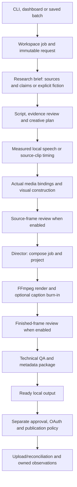

# Whole-code walkthrough

Read this from top to bottom once, then use the tables to locate the code you need. This describes the implementation inspected on 2 November 2026. [Project status](PROJECT_STATUS.md) separates code that exists from live integrations and content quality still needing validation. [PROJECT_GUIDE.md](../PROJECT_GUIDE.md) preserves architecture decisions and detailed operating history.

## 1. What the application is

There are two Python packages:

- `src/yt_pipeline/` is the production application. It turns requests into researched scripts, speech, visuals, edits, QA and publication packets. It also contains source acquisition, generation, upload and observation adapters.
- `src/shorts_editor/` is the reusable compositor. It accepts actual media and a bounded JSON recipe, then previews or renders the result. The pipeline calls it directly; routine automation does not click an editor timeline.

The folders under `agents/` explain responsibilities implemented by these modules. They are not separate processes, installed agent types or always-running assistants. One worker runs stages sequentially, and SQLite leases prevent competing production work. The dashboard has one background executor. Independent manual compositor work can still compete for PC resources.

## 2. Launchers and interfaces

| File | What it does |
| --- | --- |
| [run_pipeline.py](../run_pipeline.py) | Adds local `src` to the import path and enters the production CLI |
| [run_editor.py](../run_editor.py) | Enters the compositor CLI/server |
| [run_control.py](../run_control.py) | Builds the Tkinter Start/Pause/Status/New plan window; starts local CLI child processes |
| [start_pipeline.cmd](../start_pipeline.cmd) | Launches the native control window through the project environment |
| [start_editor.cmd](../start_editor.cmd) | Starts the local editor/server |
| [run_upgrade_demo.cmd](../run_upgrade_demo.cmd) | Runs/resumes the saved final motion-block demonstration plan |
| [pyproject.toml](../pyproject.toml) | Package/dependency definitions, optional extras, CLI entry points, web package data and pytest configuration |
| [uv.lock](../uv.lock) | Locked dependency resolution for reproducible environment installation |

The local HTTP server serves `/production` for production jobs, `/` for the supplied-media compositor and `/legacy` for older editor recipes. CLI output is JSON; progress may use stderr. Held/failed production outcomes use meaningful nonzero exits. Browser and native controls call the same modules rather than maintaining separate render implementations.

## 3. Follow a request through the code

1. [cli.main](../src/yt_pipeline/cli.py), [dashboard.Production](../src/yt_pipeline/dashboard.py) or [batches.run_batch](../src/yt_pipeline/batches.py) creates a job through `Workspace.create`. The request is saved in SQLite and `jobs/<id>/request.json`.
2. [Pipeline.run](../src/yt_pipeline/pipeline.py) acquires a global production lease and job lease. A heartbeat renews them. It checks cancellation, disk space, channel pause and existing artifact hashes before advancing.
3. `research_job` accepts a provided brief or builds a dated source/claim brief. Fictional formats can create an explicitly fictional brief without pretending to research real events.
4. `write_script` accepts a provided script or calls Gemini. It validates the structured result, duplicate script checks, evidence and playbook rules. Enabled narrated requests return three typed hook alternatives inside that writing call, with a checked selected line/caption. Playbook scripts receive a frozen-dialogue creative plan; factual playbook evidence/director verdicts share a call. Required separate editorial review validates the exact final payoff quote and shares the single substantive rewrite budget. Comedy can add concepts and a punchline review. Bounded repairs stop after their allowed attempts.
5. Voice generation produces per-unit audio and measured durations. Clip jobs instead preserve source audio and exact range timing; aura uses its own timing. The cutout/motion-graphics routes can add exact-script word alignment.
6. The visual builder uses the frozen plan or older format-specific logic, binding actual registered assets. Enabled source-frame review checks these actual bindings. A missing essential factual/movie artifact holds rather than being silently replaced with unrelated stock.
7. `direct` turns the measured units and files into `compose-job.json` and a normalized project. `shorts_editor` renders the MP4, cover, captions and manifest. Exact captions may be burned in after the clean render.
8. Enabled finished-frame review samples the actual exported MP4. `inspect_render` performs full decode, timing, dimensions, audio, evidence and asset checks. `package` builds publication metadata and provenance.
9. The job becomes `ready`. That means local production stages finished; `quality.publication_ready`, test flags, account policy, exact approval and source freshness are separate conditions. No upload happens just because the job is ready.

The checkpoint stage names are `research`, `script`, `voice`, `visuals`, `direct`, `render`, `quality`, `package`. Source-frame review is stored inside the visuals result, and finished-frame review inside render. The model's creative plan is created during writing; the later `direct` stage materializes the actual edit.

## 4. Production package: every module

| Module | What code belongs here and what it does |
| --- | --- |
| [core.py](../src/yt_pipeline/core.py) | `Workspace`, SQLite tables/transactions, immutable requests, state updates, artifact hashes, leases, retries, quotas, cooldowns, redaction and local environment loading; `Held` explains recoverable blockers |
| [pipeline.py](../src/yt_pipeline/pipeline.py) | `Pipeline.run` executes/checkpoints the eight stages; `work_once` chooses an eligible queued/retry/expired-running job |
| [cli.py](../src/yt_pipeline/cli.py) | Argument parsing, doctor/config, jobs/assets, discovery/planning, worker loop and integration commands; `tick` coordinates production and optional remote work |
| [dashboard.py](../src/yt_pipeline/dashboard.py) | `Production` exposes status/actions/output links to HTTP; serializes background pipeline work and uses the same production modules |
| [control.py](../src/yt_pipeline/control.py) | Builds local child-process commands; starts one control task and requests cooperative pause using a marker file |
| [batches.py](../src/yt_pipeline/batches.py) | Default/saved plan validation, prerequisite checks, batch leases, stable recovery tokens, job creation, pause and checked atomic export copies |
| [research.py](../src/yt_pipeline/research.py) | RSS/Atom and optional YouTube discovery, factual page collection, Gemini claim extraction, provided briefs and freshness checks |
| [net.py](../src/yt_pipeline/net.py) | Bounded public fetches, URL/network restrictions, redirect handling and basic readable HTML extraction |
| [editorial.py](../src/yt_pipeline/editorial.py) | Supplies channel/topic direction and agreed editorial scope to research/writing |
| [contracts.py](../src/yt_pipeline/contracts.py) | Validates briefs/scripts, source and claim IDs, supported formats, unit structure and fiction/factual requirements |
| [writer.py](../src/yt_pipeline/writer.py) | Gemini REST/cache/budget/cooldown and bounded image inputs; structured script writing, evidence review, duplicates and creative rewrite handling |
| [playbooks.py](../src/yt_pipeline/playbooks.py) | Defines nine executable presets and defaults: timing, words, voice, layout, source/graphic requirements and writer prompts; exports runtime contracts |
| [script_quality.py](../src/yt_pipeline/script_quality.py) | Format-aware narrated hook checks, three-option writer envelope/selection, and separate editorial verdict validation bound to the exact existing payoff quote |
| [speech_delivery.py](../src/yt_pipeline/speech_delivery.py) | Validates exact ordered text coverage, segment count, bounded internal silence/speed and finite timing values without speech tags |
| [comedy.py](../src/yt_pipeline/comedy.py) | Optional original concept generation/selection and setup/actual-punchline critique for cutout comedy |
| [creative_plan.py](../src/yt_pipeline/creative_plan.py) | Director schema and frozen dialogue/cast/scene validation; evidence/creative verdicts, supported framing and active-speaker rules |
| [voice.py](../src/yt_pipeline/voice.py) | Piper/Kokoro setup, cached segments/complete per-unit speech, accepted voice selection, real internal/thinking/end silence, measured durations/audio checks and normalization |
| [dialogue_captions.py](../src/yt_pipeline/dialogue_captions.py) | Aligns exact script tokens to actual speech with the local English alignment kernel; checks full coverage, records timing repairs and phrase groups |
| [transcripts.py](../src/yt_pipeline/transcripts.py) | Imports VTT/SRT, local faster-whisper transcription, clips cues, writes SRT and burns timed captions into video |
| [assets.py](../src/yt_pipeline/assets.py) | Registers copied media with provenance/permissions/hash/expiry; checks use eligibility, selects configured backgrounds and supports optional Pexels acquisition |
| [media_agent.py](../src/yt_pipeline/media_agent.py) | Commons search/acquisition, eligible license parsing, metadata/download cache and image/video/audio choices |
| [media_library.py](../src/yt_pipeline/media_library.py) | Rebuildable SQLite FTS index and candidate search over registered asset metadata; rechecks integrity; no semantic image classifier |
| [music_agent.py](../src/yt_pipeline/music_agent.py) | Registers music categories, selects eligible library tracks, searches candidates and keeps mood fit separate from popularity evidence |
| [source_agent.py](../src/yt_pipeline/source_agent.py) | Versioned permitted source profiles, bounded downloads/local ingestion, transcript acquisition and source/transcript hash checkpoints |
| [clip_agent.py](../src/yt_pipeline/clip_agent.py) | Transcript-grounded cue-index selection, exact-range deduplication, bounded clip job creation and reference-to-catalog handoffs |
| [clips.py](../src/yt_pipeline/clips.py) | Validates actual source clip bounds and prepares original-audio timing, skipping TTS |
| [browser_agent.py](../src/yt_pipeline/browser_agent.py) | Provider generation job records, Brave/persistent/CDP session access, explicit selector/cost preflight, one submission, reconciliation/download/import and production dependency |
| [generation_settings.py](../src/yt_pipeline/generation_settings.py) | Chooses supported adequate duration/resolution/thinking from declared capabilities; applies native/custom controls and verifies read-back |
| [visuals.py](../src/yt_pipeline/visuals.py) | Older timed chat/lesson/stock graphics and route selection for non-plan visuals |
| [planned_visuals.py](../src/yt_pipeline/planned_visuals.py) | Executes creative plans with registered stills/clips, ranked cards, cast layouts, camera moves, panels, source bindings and graphic scenes |
| [cast_body.py](../src/yt_pipeline/cast_body.py) | Draws original clothed human-shaped silhouettes and assigns stable shirt colors by actor identity |
| [storyboard.py](../src/yt_pipeline/storyboard.py) | Bounded mystery scene tags, story-derived props and original procedural illustrated scenes for the older mystery route |
| [montage.py](../src/yt_pipeline/montage.py) | Per-unit three-block montage planning/rendering; demands explicit relevant bindings or explicitly decorative media |
| [entertainment.py](../src/yt_pipeline/entertainment.py) | Aura timing and entertainment-specific visual/effect helpers |
| [scene_blocks.py](../src/yt_pipeline/scene_blocks.py) | Validates/draws exact-script comparison/process/callout blocks and frame-counted quiz timers; supports Before/After and Myth/Fact comparison headings |
| [edit_blocks.py](../src/yt_pipeline/edit_blocks.py) | Describes/exports the supported editing vocabulary and schemas; it is not an arbitrary effects-graph/code executor |
| [director.py](../src/yt_pipeline/director.py) | Resolves measured units, file paths, source offsets, provenance, layout, effects and audio into the final compositor recipe/project |
| [visual_review.py](../src/yt_pipeline/visual_review.py) | Samples source/finished frames, builds labeled contact sheets, sends actual images to Gemini and validates item-bound verdicts in off/report/required modes |
| [quality.py](../src/yt_pipeline/quality.py) | Full audio/video decode, dimensions/timing/audio clipping, source/asset/editorial state, publication readiness and metadata/credits/disclosure packaging |
| [publishing.py](../src/yt_pipeline/publishing.py) | Owner OAuth, channel identity, exact-version approval, network-free preview, resumable private/scheduled uploads, saved offsets and remote reconciliation |
| [benchmarks.py](../src/yt_pipeline/benchmarks.py) | Public video view/date snapshots, lifetime age-normalized references and later observed view deltas; no competitor private analytics |
| [monitor.py](../src/yt_pipeline/monitor.py) | Local alerts/asset/disk/lease checks, incident pause, optional remote reconciliation, owned checkpoints and simple growth hypotheses |
| [__init__.py](../src/yt_pipeline/__init__.py) | Package marker; no independent production agent |

## 5. Compositor package: every module

| Module | Purpose |
| --- | --- |
| [cli.py](../src/shorts_editor/cli.py) | `serve`, format listing, composition/render commands and machine-readable output |
| [server.py](../src/shorts_editor/server.py) | Loopback HTTP routes, request/session/origin checks, media import, save/preview/export/download and editor job queue/restart/cancellation |
| [store.py](../src/shorts_editor/store.py) | Editor workspace, imported media probing/copies, ID/path checks, saved projects and atomic JSON writing |
| [models.py](../src/shorts_editor/models.py) | Project/scene defaults, recipe validation, supported bounds, formats and dimensions |
| [jobspec.py](../src/shorts_editor/jobspec.py) | Materializes program-facing JSON and real media paths into a registered normalized project |
| [composition.py](../src/shorts_editor/composition.py) | Overlay/stack/focus/multiblock placement, crop/contain/blur, shot inputs, borders/CTA/effects and selected audio filter construction |
| [render.py](../src/shorts_editor/render.py) | Still preview, bounded FFmpeg subprocesses, progress/cancellation, shot rendering/assembly and final MP4/PNG/SRT/project/manifest outputs |
| [graphics.py](../src/shorts_editor/graphics.py) | Fonts, wrapping, readable text boxes and legacy graphic/card layers |
| [demo.py](../src/shorts_editor/demo.py) | Explicitly requested synthetic technical fixtures/demo media; ordinary startup does not create them |
| [__init__.py](../src/shorts_editor/__init__.py) | Package metadata/marker |

The [web folder](../src/shorts_editor/web) uses plain HTML/CSS/JavaScript, without a Node build. `studio.html`, `studio.js`, `studio.css` implement the default compositor; `production.html`, `production.js`, `production.css` implement the queue/dashboard; `index.html`, `app.js`, `style.css` preserve the legacy editor. `education-request.json` is its supplied technical example. Server routing determines which page is served at each URL. See [the compositor guide](guides/COMPOSITOR.md) for user/API details.

## 6. Files and data contracts

| Object/file | Meaning and main producer |
| --- | --- |
| `request.json` | User/program intent, channel format/playbook, sources/assets, test/review flags; `Workspace.create` |
| `research.json` | Brief, source excerpts/dates, source-linked claims or explicit fiction; `research_job` |
| `script.json` | Structured dialogue, metadata, writing origin, reviews and optional creative plan/concepts; `write_script` |
| `voice.json` | Real durations/start offsets and audio file references, plus optional aligned cues; voice/clip/aura route |
| `visuals.json` | Built visual units, captions, actual source bindings and source review; visual builder |
| `direct.json` / `compose-job.json` | Real files/timing/layout/provenance and project identity; director |
| `render.json` | Export paths/duration and enabled finished-frame review; pipeline renderer |
| `quality.json` / `qa.json` | Technical checks, video hash, test/publication flags and review status; quality module |
| `package.json` / `metadata.json` | Exact publication packet, credits, source URLs and disclosure; packager |
| `video.mp4`, `.png`, `.srt`, `.project.json`, `.manifest.json` | Actual media and normalized recipe/render evidence; compositor |
| `visual-review/` | Sampled frames, labeled contact sheets, bound model observations and limits |
| Saved plan / `batch.json` | Versioned input items and durable job/export associations; batch runner |

Stage files are wrapper results, not necessarily the same shape as an imported request. In particular, a saved `script.json` includes origin/reviews around its nested script. Use the request examples/contracts instead of passing a whole stage wrapper as a raw script.

`data/pipeline/pipeline.sqlite3` contains `jobs`, `events`, `assets`, `usage`, `uploads`, `observations`, `alerts`, `worker_locks`, `public_snapshots` and `provider_cooldowns`. Media search adds FTS tables. `config.json` controls channels/voices/model budgets; environment variables hold API keys, and private OAuth files live under credentials. Never copy credentials into docs, examples or research.

Registered source profiles and browser generation jobs use their own directories/files. Pipeline media is copied into the local stores. A project JSON alone is insufficient to transfer the project: preserve the referenced media and private state. Existing artifact checks use absolute paths and SHA-256 hashes, which is why this reorganization leaves runtime media/checkpoints in place.

## 7. State, recovery and failures

`queued → running → ready` describes local production. A recoverable missing input or review problem produces `held`; a timed retry uses `retry_wait`; unexpected exceptions use `failed`; cancellation uses `cancelled`. Uploaded jobs can become `processing`, `uploaded_private`, `scheduled` or `published`.

Existing completed stages are reused only if their JSON and referenced file hashes still match. `retry --from-stage` resets the chosen stage and downstream checkpoints, and invalidates publication approval. It does not justify editing a saved completed artifact by hand. Leases expire after a crashed worker; a new worker can reclaim work. Cancellation/pause is cooperative, so an in-flight model request or current batch video may finish first.

Provider cooldowns and the separate UTC daily local call budget persist across restarts. Content-bound caches can reuse successful calls. No paid fallback/key rotation is added by the guides. A held job needs the actual missing input/fix; blindly resetting upstream stages can waste calls.

## 8. Technology choices and tradeoffs

| Technology | Why it is here | Tradeoff/alternative |
| --- | --- | --- |
| Python | Existing renderer, orchestration, local models and lightweight server share one runtime | A separate Node/cloud service would increase deployment/state work; not needed for these bounded formats |
| Pillow | Deterministic text, silhouettes, cards and graphic plates | Excellent for trusted graphic layouts; limited character acting/rigging compared with animation systems |
| FFmpeg/ffprobe | Actual media inspection, filters, encoding, captions and decode checks | Powerful and local; filter complexity/platform issues need actual-render regression tests |
| SQLite WAL + JSON | Transactional single-PC state plus inspectable stage artifacts | No always-available cloud/distributed operation; immutable paths/hashes require deliberate migrations |
| Gemini REST | Structured script/plan/evidence and sampled-image review using one configured provider | Quotas, variable creative judgment and availability remain; no guarantee of entertaining results |
| Kokoro/Piper + ONNX | Local CPU speech without per-video TTS service calls | Voice/model licensing is separate; acting/languages require evaluation |
| faster-whisper | Local transcription and exact-script English alignment route | Names/timing can be wrong; word coverage does not prove perfect sync |
| Playwright | Explicit browser settings/preflight/download automation with local sessions | Provider UI changes and real account allowance need calibration; fixtures are not a live integration |
| requests / Google OAuth libraries | Official account consent, authenticated upload and Analytics adapters | Owner connection and real remote validation are pending |
| Tkinter / plain web files | Small native control panel and local UI without another frontend build | New media/generation/playbook features remain more complete in CLI than dashboard forms |

The retained Python/FFmpeg architecture and free-only policy are recorded decisions in the project guide. Some dependency choices are pragmatic explanations inferred from their use (for example plain web files avoiding a build), not claims about an undocumented original design discussion. Remotion, Manim, native editors and cloud hosting remain optional proposals.

## 9. Tests, tools and examples

| Test file | Main evidence |
| --- | --- |
| `test_editorial_improvements.py` | Same-call hook selection, exact separate reviews/holds/rewrite budget, clean speech coverage and cached internal silence, real countdown frames and a complete synthetic-speech quiz export |
| `test_pipeline.py` | Contracts, state/leases, quota/cache/env, source guards, simulated uploads/recovery and public snapshots |
| `test_pipeline_integration.py` | Actual pipeline exports, source audio, held-job resume and production HTTP controls |
| `test_agents.py` | Editorial scope, media/license contracts, transcripts, source handoffs, actual caption burn-in and browser fixtures |
| `test_playbooks.py` | Frozen dialogue/speakers, writing/directing, evidence, framing, caption coverage, visual inputs and actual scene behavior |
| `test_visual_review.py` | Actual image transport/cache identity, wrong/unknown holds, review completeness, graphic contracts and real block render |
| `test_storyboard.py` | Per-unit visual bindings, explicit decorative media, cut bounds and actual story props |
| `test_generation_worker.py` | Local browser fixtures for supported settings, cost/read-back, session boundaries and no duplicate submissions |
| `test_batches.py` | Stable jobs/copies, concurrent starts, crash recovery, plan integrity and prerequisite holds |
| `test_control.py` | Local child process command/pause semantics |
| `test_composition.py` | Real layouts, pixels, effects, source audio, reusable layouts and JSON caller behavior |
| `test_editor.py` | Legacy exports, dimensions, HTTP, path isolation, cancellation and restart behavior |

The initial audit suite passed 183 tests. After editorial/speech/quiz improvements the complete suite passed 210 tests in 118.40s with the same two Pillow deprecation warnings. Many tests use controlled fixtures or fake external transports. They prove bounded behavior, not real Google/YouTube integration or audience quality.

`tools/build_blueprint_pdf.py` and `blueprint_content.py` build the dated PDF explanation with ReportLab. `build_edit_gallery.py` and `build_motion_block_gallery.py` create technical visual previews. `create_upgrade_demo.py` builds a new demo plan/source excerpt when absent; it can fetch external data, so it is not a read-only checker. [create_editorial_demo.py](../tools/create_editorial_demo.py) renders/resumes a test-only prepared rewrite fixture with real local voice/alignment, no model calls and an explicitly offline plan. [check_project_docs.py](../tools/check_project_docs.py) checks local Markdown links and the organization move map without making provider calls.

[Examples](../examples/README.md) retain stable paths used by tests. [Resources](../Resources/README.md) indexes plans/prompts/exports; its subfolder indexes explain mixed historical formats. Generated contracts should come from `playbooks --export`, not a hand-maintained duplicate.

## 10. Where to make a change

| Desired change | Start here, then validate |
| --- | --- |
| New content category | `playbooks.py`, `creative_plan.py`, supported visuals/batch prerequisites; add a category recipe and relevant contract/render checks |
| Better script/story logic | `writer.py`, `comedy.py`, playbook prompts; assess whole real episodes as well as schemas |
| Different voice/pacing | `voice.py` and preset delivery; check measured duration, intelligibility and exact caption coverage |
| New scene/graphic | `scene_blocks.py`, `edit_blocks.py`, schema and `planned_visuals.py`; validate real pixels/timing and supported inputs |
| Relevant media | `media_agent.py`, `media_library.py`, input bindings and `visual_review.py`; validate the actual chosen range/subject |
| Composition/effect | `shorts_editor/models.py`, `jobspec.py`, `composition.py`/`render.py`; run an actual FFmpeg regression |
| Provider-browser control | `generation_settings.py`, `browser_agent.py`, calibrated selector files; first fixtures, then deliberate real-page validation |
| Recovery/queue | `core.py`, `pipeline.py`, `batches.py`; test crash/resume/contention and immutable evidence |
| Dashboard form | `production.html/js/css`, `dashboard.py`, server route; check HTTP/session boundaries and actual browser usability |
| Upload/account behavior | `publishing.py`; fake transport tests plus owner-connected private upload/recovery validation |
| Performance learning | `monitor.py`, `benchmarks.py`; preserve missing data and compare real format/duration cohorts |

Keep current implementation status and the affected `PROJECT_GUIDE.md` sections synchronized. Add a new abstraction when the actual change needs it; the agent folders do not require a package refactor.
